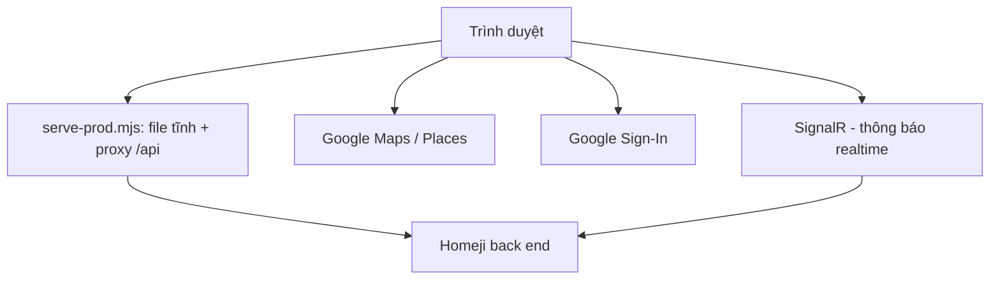

<div align="center">


# 🏠 EXE101 · Homeji Web

**Nền tảng kết nối chủ trọ và người thuê · Tìm phòng trên bản đồ · Tìm bạn ở ghép · Đăng tin**


**[Dự án làm gì?](#-dự-án-làm-gì) · [Chức năng chính](#-chức-năng-chính) · [Cách sử dụng](#-cách-sử-dụng) · [Bản chạy thật](#-bản-chạy-thật) · [Tech stack](#-tech-stack) · [Kiến trúc](#-kiến-trúc) · [Chạy local](#-chạy-local) · [Tài liệu](#-tài-liệu)**

</div>

---

## 📖 Dự án làm gì?

Homeji là nền tảng kết nối **chủ trọ và người thuê**: tìm phòng, tìm bạn ở ghép và đăng tin trên bản đồ. Repo này là **web front end** (`exe-homeji-web`), làm trong môn **EXE101** tại Đại học FPT, hướng tới sinh viên và người đi làm quanh khu vực Thủ Đức và Quận 9 (TP.HCM). Giao diện bằng tiếng Việt.

Ứng dụng di động (`exe-homeji-mobile`) là dự án riêng, dùng chung back end và **không** nằm trong repo này.

Phiên bản khai báo nằm trong [package.json](package.json); phiên bản cài đặt được khóa trong [package-lock.json](package-lock.json).

| 🗺️ Bản đồ | 📝 Tin đăng | 💬 Tương tác | 🛡️ Quản trị |
|---|---|---|---|
| Lọc tin trên Google Maps, chi tiết địa điểm, geocoding, chỉ đường | Chủ trọ tạo/sửa tin, tìm bạn ở ghép, tin cần thuê, tin đã lưu, chợ đồ cũ | Chat, lịch hẹn, thông báo realtime (SignalR) | Khu vực `/admin` kiểm duyệt nội dung |

## ✨ Chức năng chính

Route được khai báo trong [src/App.tsx](src/App.tsx). Phần lớn màn hình sau đăng nhập không phải trang riêng mà mở thành **panel trên bản đồ chính** (route cũ tự chuyển hướng về trang bản đồ kèm panel tương ứng).

### 👤 Khách (chưa đăng nhập)

| Chức năng | Route | Làm gì |
|---|---|---|
| Trang giới thiệu | `/` | Giới thiệu Homeji |
| Bản đồ khám phá | `/explore` | Duyệt và lọc tin cho thuê trên Google Maps; chi tiết địa điểm, chỉ đường |
| Đăng ký / đăng nhập | `/register`, `/login`, `/auth/callback` | Tạo tài khoản; đăng nhập email/mật khẩu hoặc Google |
| Quên / đặt lại mật khẩu | `/forgot-password`, `/reset-password` | Khôi phục mật khẩu |
| Chính sách | `/privacy`, `/terms` | Chính sách riêng tư, điều khoản |

### 🏠 Người dùng đã đăng nhập (chủ trọ / người thuê)

| Chức năng | Route | Làm gì |
|---|---|---|
| Đăng tin mới | `/posts/new` | Tạo tin cho thuê |
| Sửa tin | `/posts/:postId/edit` | Chỉnh sửa tin của mình |
| Tin của tôi | `/my-posts` | Mở panel quản lý tin đã đăng |
| Chợ đồ cũ | `/marketplace` | Mở panel chợ trên bản đồ |
| Tin cần thuê (ở ghép) | `/wanted` | Mở panel tin tìm phòng / tìm bạn ở ghép |
| Hoạt động | `/activities` | Mở panel hoạt động |
| Tin đã lưu | `/saved` | Mở panel tin đã lưu |
| Hồ sơ | `/profile` | Mở panel hồ sơ cá nhân |
| Thông báo · Lời mời | `/notifications`, `/invitations` | Mở panel thông báo realtime (SignalR) và lời mời |
| Thanh toán | `/payments`, `/payments/wait` | Mở panel thanh toán; trang chờ xác nhận thanh toán |
| Xem chi tiết tin | `/posts/:postId` | Chuyển về bản đồ và mở thông tin tin trong panel |

Chat và lịch hẹn nằm trong giao diện bản đồ (không có route riêng). Các tính năng AI (tìm kiếm ngôn ngữ tự nhiên, trợ lý soạn tin, tóm tắt admin…) bật/tắt qua biến `VITE_AI_*`.

### 🛡️ Admin

| Chức năng | Route | Làm gì |
|---|---|---|
| Kiểm duyệt nội dung | `/admin` | Trang kiểm duyệt, chỉ tài khoản admin vào được (`AdminRoute`) |

Ngoài ra: chế độ sáng/tối, giá hiển thị bằng VND.

## 🧭 Cách sử dụng

Dùng bản chạy thật tại [homeji.onrender.com](https://homeji.onrender.com), hoặc [chạy local](#-chạy-local) rồi mở địa chỉ Vite in ra ở terminal.

1. **Xem thử với tư cách khách**: vào `/` để xem giới thiệu, sang `/explore` để duyệt tin trên bản đồ.
2. **Đăng ký / đăng nhập**: dùng `/register` và `/login` (email/mật khẩu hoặc Google). Quên mật khẩu thì dùng `/forgot-password`. Đăng nhập bằng Google cần `VITE_GOOGLE_CLIENT_ID` khi chạy local.
3. **Tìm phòng**: trên bản đồ, lọc/tìm tin, mở một tin để xem chi tiết trong panel và chỉ đường.
4. **Đăng tin (chủ trọ)**: sau khi đăng nhập vào `/posts/new`, điền form tạo tin; quản lý và sửa tin ở panel *Tin của tôi* (`/my-posts`) hoặc `/posts/:postId/edit`.
5. **Lưu tin và tìm bạn ở ghép**: dùng panel *Tin đã lưu* (`/saved`) và *Tin cần thuê* (`/wanted`).
6. **Theo dõi thông báo, thanh toán**: mở panel *Thông báo* (`/notifications`) và *Thanh toán* (`/payments`).
7. **Admin**: tài khoản admin vào `/admin` để kiểm duyệt nội dung.

> Repo không có tài khoản demo. Chạy local cần back end Homeji (xem `VITE_API_BASE_URL` / `API_PROXY_TARGET`); các luồng dữ liệu chi tiết (chat, lịch hẹn, gói thanh toán) do back end quyết định và chưa kiểm chứng đầy đủ từ repo web này.

## 🌐 Bản chạy thật

| | URL |
|---|---|
| Website | [https://homeji.onrender.com](https://homeji.onrender.com) |

## 🧰 Tech stack

### Giao diện & routing

| Công nghệ | Phiên bản khai báo | Vai trò |
|---|---|---|
| React · React DOM | `^19.2.7` | Thư viện UI |
| TypeScript | `~6.0.2` | Kiểu tĩnh (`tsc -b` trong build) |
| Vite | `^8.1.1` | Dev server và build |
| React Router | `react-router-dom ^7.18.1` | Điều hướng |
| CSS | CSS thuần + CSS variables | Style, chế độ sáng/tối |

### Bản đồ, đăng nhập & realtime

| Thành phần | Công nghệ | Cách dùng |
|---|---|---|
| Bản đồ | Google Maps JavaScript API + Places | Tìm kiếm, địa điểm, chỉ đường |
| Gom marker | `@googlemaps/markerclusterer ^2.6.2` | Gom nhóm marker trên bản đồ |
| Đăng nhập Google | `@react-oauth/google ^0.13.5` | Google sign-in |
| Realtime | `@microsoft/signalr ^10.0.0` | Thông báo realtime |

### Hiển thị & animation

| Công nghệ | Phiên bản khai báo | Vai trò |
|---|---|---|
| Motion | `^14.2.0` | Animation |
| GSAP | `^3.15.0` | Animation |
| Three.js | `^0.186.1` | Hiệu ứng 3D |
| Lenis | `^1.3.25` | Cuộn mượt |
| dotLottie React | `^0.19.9` | Animation Lottie |

### Tooling & hosting

| Nhóm | Công cụ |
|---|---|
| Lint | ESLint `^10.6.0`, typescript-eslint `^8.62.0`, eslint-plugin-react-hooks, eslint-plugin-react-refresh |
| Test | `node:test` (contract test trong [`tests`](tests)) |
| Server production | [`scripts/serve-prod.mjs`](scripts/serve-prod.mjs): phục vụ file tĩnh và proxy `/api` |
| Hosting | Render Web Service ([render.yaml](render.yaml)) |
| Package | npm + `package-lock.json` |

## 🏗️ Kiến trúc



Server production phục vụ bản build và proxy `/api` tới back end của Homeji, nên trình duyệt không cần cấu hình CORS. Khi dev, dev server cũng proxy `/api`.

## 🧩 Module

| Thư mục | Phạm vi |
|---|---|
| [`src/api`](src/api) | Code gọi API |
| [`src/components`](src/components) | Thành phần UI |
| [`src/contexts`](src/contexts) | React context |
| [`src/hooks`](src/hooks) | Hook dùng chung |
| [`src/lib`](src/lib) | Hàm hỗ trợ, nhãn, motion token |
| [`src/pages`](src/pages) | Các trang |
| [`src/App.tsx`](src/App.tsx) | Định nghĩa route |
| [`scripts/serve-prod.mjs`](scripts/serve-prod.mjs) | Server production (file tĩnh + proxy `/api`) |
| [`tests`](tests) | Contract test bằng `node:test` |
| [`deploy`](deploy) · [`docs`](docs) · [`public`](public) | Tài liệu deploy, tài liệu dự án, tài nguyên tĩnh |
| [`render.yaml`](render.yaml) | Blueprint Render Web Service |

## 🚀 Chạy local

Cần Node.js, npm, và một project Google Cloud có Maps API key cùng OAuth client ID.

```bash
npm install
cp .env.example .env
npm run dev
```

Điền giá trị riêng của bạn vào `.env`; không commit secret. [`.env.example`](.env.example) liệt kê các Google API cần bật cho Maps key (Maps JavaScript, Places, Geocoding, Routes và một số API tùy chọn).

### Biến môi trường (chỉ tên — không dán secret)

| Biến | Mục đích |
|---|---|
| `VITE_API_BASE_URL` | URL gốc của back end. Để trống để gọi `/api` cùng origin (dev server và `serve-prod.mjs` sẽ proxy). |
| `API_PROXY_TARGET` | URL back end mà `scripts/serve-prod.mjs` dùng khi chạy. |
| `VITE_GOOGLE_MAPS_API_KEY` | Google Maps API key. |
| `VITE_GOOGLE_MAP_ID` | Cloud Map ID (tùy chọn; vector map, advanced marker). |
| `VITE_GOOGLE_CLIENT_ID` | Client ID cho Google sign-in. |
| `VITE_AI_NATURAL_SEARCH`, `VITE_AI_DECISION_TOOLS`, `VITE_AI_DRAFT_ASSISTANT`, `VITE_AI_ADMIN_SUMMARY`, `VITE_AI_SOURCE_BROWSER`, `VITE_AI_COMMUTE` | Cờ bật/tắt tính năng AI (`true`/`false`). |

## 🧪 Lệnh development

```bash
npm run dev             # Dev server
npm run build           # tsc -b && vite build
npm start               # Chạy bản build (serve-prod.mjs)
npm run lint            # ESLint
npm run test:contracts  # Contract test
```

Ngoài ra còn các script test khác như `test:nearby`, `test:traffic`, `test:admin-analytics` (xem [package.json](package.json)).

## ☁️ Deployment

Homeji chạy trên **Render** dưới dạng Node web service ([render.yaml](render.yaml)).

| Cấu hình | Giá trị |
|---|---|
| Build | `npm install && npm run build` |
| Start | `npm start` |
| Production URL | [https://homeji.onrender.com](https://homeji.onrender.com) |

Server phục vụ bản build và proxy `/api` tới back end của Homeji. Ngoài ra repo có hướng dẫn deploy cho Windows tại [deploy/windows/README.md](deploy/windows/README.md).

## 📚 Tài liệu

| Tài liệu | Nội dung |
|---|---|
| [Deployment target](docs/deployment-target.md) | Ghi chú về môi trường deploy |
| [Map capabilities](docs/MAP_CAPABILITIES.md) | Khả năng của bản đồ |
| [Payment expiration](docs/payment-expiration.md) | Hết hạn thanh toán |
| [Website traffic](docs/website-traffic.md) | Theo dõi lượng truy cập |
| [Admin product analytics](docs/admin-product-analytics.md) | Thống kê sản phẩm cho admin |
| [Windows deploy](deploy/windows/README.md) | Hướng dẫn deploy trên Windows |

## 👥 Team

Nhóm Homeji, EXE101, Đại học FPT. Chủ repo: [@fogit-hd](https://github.com/fogit-hd).

---

<div align="center">

**EXE101 · FPT University · Homeji Web**

Chưa có file license trong repo.

</div>
